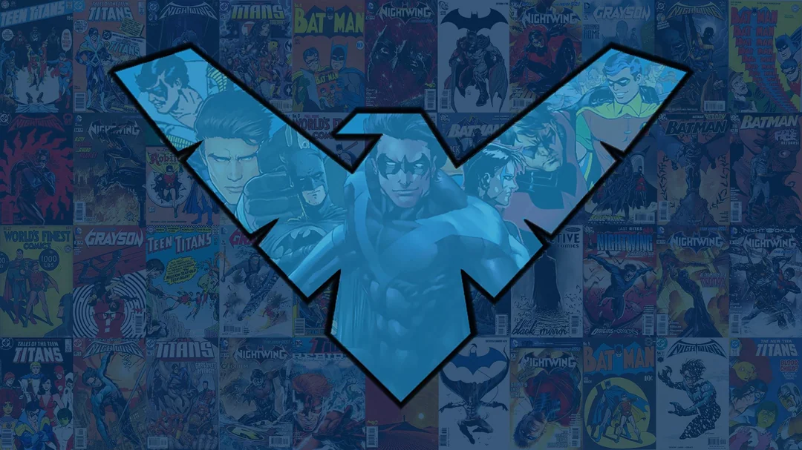

  

<h3 align="center"><code>courage-code-conquer</code></h3>

  
  &nbsp;&nbsp;&nbsp;
  
  &nbsp;&nbsp;&nbsp;
  
  &nbsp;&nbsp;&nbsp;
  

### `~$ functions`

Patrolling the city by day, shipping code by night.

### `~$ ls ~/gadgets`

- [langX](https://github.com/RohanOnKeys/langX) - fault-tolerant LangGraph agents on HPX. Kill a worker mid-step and nothing is lost or committed twice.
- [Ariadne](https://github.com/RohanOnKeys/Ariadne) - astrodynamics toolkit for orbit propagation, EKF/UKF estimation and conjunction screening on live satellite catalogs.
- [North-Star](https://github.com/RohanOnKeys/North-Star) - encrypted, resumable data transfer that survives broken satellite pass windows.
- [Freight](https://github.com/RohanOnKeys/Freight) - distributed CI/CD with DAG scheduling, Docker runners and dead-runner recovery.
- [Crabbit](https://github.com/RohanOnKeys/crabbit) - search engine in Rust and Tokio with BM25 ranking.
- [Visor](https://github.com/RohanOnKeys/Visor) - compiles the DOM into clean, usable context for browser agents.
- Borrowed from the Batcave: electrified Escrima sticks, grapple guns, wing-gliders, and a pocket full of smoke and flash pellets.

### `~$ git log --upstream`

- [HPX](https://github.com/TheHPXProject/hpx/pulls?q=is%3Apr+author%3ARohanOnKeys+is%3Amerged) - multiple merged PRs to the C++ runtime for parallelism and concurrency. Locality supervision races, thread-safe counters, scheduler fixes, CUDA and MSVC builds.
- [CRIU](https://github.com/checkpoint-restore/criu/pull/3164) - 2 merged fixes. Checkpoints in fresh network namespaces, and a mountinfo parser that no longer chokes on long containerd OverlayFS entries.

### `~$ cat ~/next`

- interactive frontends for agents
- hardware that orchestrates itself
- deeper into low-level systems
- fighting supervillains

### `~$ remote -v`

[Rohax.in](https://rohax.in)
